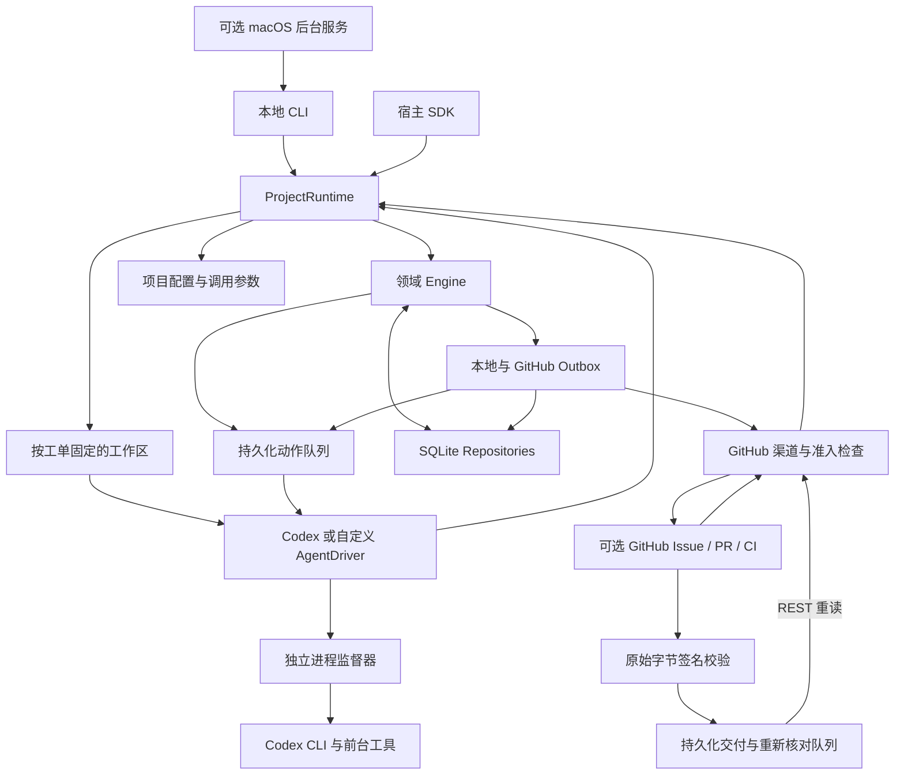

# 架构与边界

## 当前结构

CLI 与 `createProjectAgent()` 已接通提取的领域 `Engine`。一个运行时管理一个本地项目，使用独立 SQLite 状态；目标目录不要求 Git、GitHub 或 Node.js 项目结构。

`js-superagent/core` 继续提供独立领域入口；它不会自动访问项目数据库。根 SDK 中的 `core` 命名空间指向同一内核。上游核心源码保持原样，导入只涉及核心内部模块和 `node:crypto`。

## 组件职责

| 组件 | 负责什么 |
|---|---|
| `src/core/` | 事件、话题、决策、授权、工单、派工、输入、报告及其领域规则 |
| `src/store.mjs` | 实现 `Repositories`，保存领域对象、兼容元数据、动作和消息收据；提供嵌套同步事务 |
| `src/effects.mjs` | 动作去重、领取、代次保护、延迟重试与死进程领取恢复 |
| `src/outbox.mjs` | 消息与发送动作一起保存，提供本地收据、远端送达记录、去重和撤回 |
| `src/channels/github.mjs` | 通过 App installation 或已登录 `gh` 拉取 Issue、已关联 PR、审阅及显式启用的 CI；分页读取并核对、发送结果 |
| `src/channels/github-app.mjs` | App JWT、单仓库 installation token、内存缓存和 Bot 身份核对；不依赖 DSH 或 gh |
| `src/channels/github-webhook.mjs` | 原始请求 HMAC 校验、显式 HTTP 监听、请求限额与退出 |
| `src/github-webhook-inbox.mjs` | Webhook secret 引用读取、仓库／安装／关联范围路由及配置指纹 |
| `src/github-intake.mjs` | GitHub 事件校验、命令识别、身份与来源范围匹配、领域 Trigger 转换 |
| `src/github-pull-intake.mjs` | PR 元数据与提交校验、审阅／CI 事件准入、可执行反馈判定和上下文组装 |
| `src/migration.mjs` | 校验并导入 v1 工单，保留公开 ID、原始记录、消息和报告 |
| `src/index.mjs` | 组装 Engine 端口，维护兼容视图、项目执行所有权、Driver 调用、调度与停止 |
| `src/config.mjs` | 旧配置兼容、字段校验、有效配置合并、原子持久化 |
| `src/workspaces.mjs` | Git worktree／普通目录复制、准备日志、身份校验和基线变更检查 |
| `src/drivers/codex.mjs` | Codex 结构化报告、原生会话接续、逐次日志、超时与取消 |
| `src/drivers/codex-supervisor.mjs` | 父进程失联时停止 CLI 与已追踪的工具进程；保留执行占用直到清理结束 |
| `src/service.mjs` | 显式安装与管理 macOS launchd 用户服务，选择 `poll`／`webhook`，维护服务归属、进程生命周期和日志；不改变工单恢复规则 |
| `bin/js-superagent.mjs` | 本地命令、单轮 `run`、前台 `serve`、诊断、可选 `github sync/status/link/unlink/listen/webhook-status` 与 `service` 管理命令 |

存储和运行时适配参考上游的边界独立实现，没有复制上游应用层的 Store、Effects、Outbox 或 DSH Runtime。它们不是上游完整运行时的逐项移植。

## 事务与待执行动作

Engine 的修改命令在同一个同步 SQLite 事务中更新领域记录，并通过端口保存启动、投递、停止、评估或回复动作。事务回滚时，对应动作、收据和元数据一起回滚；Handler 只能在事务提交后执行。

队列按动作种类和键去重。运行中的同键动作收到新输入时增加代次；旧尝试只能结束自己的代次，不能删除新动作。领取记录包含 token、主机与进程身份，避免多个运行时重复领取同一条。普通 Handler 失败保存错误和指数退避时间；`Later` 只延后，不增加失败次数。

Driver 的执行异常另由运行时写成失败报告，需要显式重试。队列重试不是对所有 Agent 外部操作的自动重复许可。此实现提供可恢复的至少一次动作处理，不承诺外部副作用恰好一次。

## CLI/SDK 兼容与领域状态

原有公开工单 ID 和兼容字段保持可用；`get()`、`list()` 返回原来的状态集合。当前状态由领域对象、待执行动作及活跃运行记录推导，兼容元数据保存原始请求、公开历史和领域 ID 映射。

`getDomainTicket(id)` 展示当前领域对象；Driver 增加接收 `domainTicket` 与 `assignmentId`，原 `ticket` 和 `runId` 保留。项目执行记录绑定公开工单、领域工单、派工和运行 token；结果写回前检查身份，拒绝迟到结果覆盖新运行。

同项目只允许一轮 Driver 执行。默认原地执行以保持旧行为；启用 `auto`、`worktree` 或 `copy` 后，每个工单使用固定隔离目录。SQLite 全项目执行记录控制所有权，工作区元数据保存模式、路径和基线。Git worktree 和复制目录提供文件工作区隔离，不能代替容器等 OS 安全边界。

准备日志先于外部工作保存，失败会成为工单失败并要求显式重试。工作区身份缺失或不一致时拒绝执行，不静默切回源目录。Driver 收到的 `projectRoot` 是执行目录；`sourceProjectRoot` 与运行时自身的 `projectRoot` 保持原项目。原生会话与工作区一起复用，旧版本已执行的原地会话不会因新配置被移动。

## 输入与执行

本地请求生成 `local` 来源的 Trigger 和 Thread。初始明确委托通过 Engine 接单；回复进入同一话题，经订阅送达已有工单。Driver 每轮接收完整兼容快照及领域记录。

GitHub 是可选输入。首次接单要求仓库／Issue 范围、允许的用户身份和明确命令全部匹配；已关联 Issue 的后续允许用户评论进入原工单，完成后的反馈可以重新唤醒执行。GitHub 事件 ID、Issue 到公开工单的映射和输入记录一起持久化，重复拉取不会重复接单。普通评论不自动恢复失败、取消或中断的工单，这些状态仍需本地显式重试。

签名 Webhook 保存的是重新核对提示：验签并检查配置范围后，delivery 元数据、正文哈希、路由选择条件和待处理动作在同一 SQLite 事务中落盘，再应答 HTTP。后台下一调度轮调用已有 REST 同步，与轮询复用相同原生事件 ID 和准入规则，不直接执行 payload 正文。交付重复、哈希冲突、配置变化、网络退避和重启恢复均有持久记录；原始 payload 和签名不保存。请求接收和 Worker 执行分开，网络接收不会抢占现有执行。细节见 [GitHub App 与 Webhook](github-app-webhook.md)。

PR 通过可信本地 `linkGitHubPullRequest()` 关联已有工单，读取并固定同仓库当前 head SHA；不会创建新工单或改变工作目录。允许账号的审阅、行内评论和 PR 会话评论进入原工单。显式 CI 策略检查 check run 的 App slug，或同时检查 commit status 的 context 与创建账号；当前提交的可修复失败进入上下文，成功等非修复结论只记录状态。

PR 绑定保存原工单、提交、历史显式关联提交和最后观察结果，兼容视图通过 `Ticket.pullRequests` 暴露，`githubStatus()` 统一提供跟踪列表。执行前重新读取 PR 元数据，head 改变或关闭时暂缓；一旦观察到这一变化，即使远端后来恢复原状态也须显式重新关联。不会自动 fetch、checkout 或 rebase。操作者检查工作区后须显式关联所选提交；历史提交只用于标明并回传已经产生的旧版本结果。`unlink` 移除 PR 反馈入口并撤回待发 PR 结果，不中止已执行中的 Worker。

未执行输入可以被后续事实取代：新 head 关联作废旧提交反馈，最新 CI 状态作废同一检查的待执行旧失败。公开消息保留 `triggerId` 和 `superseded` 事实，Driver 快照排除失效输入，不伪造已读确认或报告。若不再有当前有效反馈，运行时不启动 Worker；核心派工可以暂时保持待处理状态，后续有效反馈继续使用原工单。CI 事件在本地按 PR 加入身份后缀，保留 `remoteEventId`，避免同一原生检查 ID 在不同 PR 间相互去重。

内核记录哪些输入已交给本轮执行；成功报告返回后，运行时确认本轮交付的输入已被 Driver 处理。这是适配器层的确认，不是模型内部读取的独立证据。执行中新增输入保留为后续工作，不会随当前完成报告丢失。Codex 后续轮次恢复指定原生会话；当前仍不支持向正在生成的轮次实时插入消息。

结果合同保持 `{ status: 'completed' | 'waiting', summary, artifacts? }`。`waiting` 映射为需要回答的问题，并按工单来源保存在本地或回传 GitHub；成果路径目前是报告元数据，不自动验证文件存在、质量或测试真实性。

## 调度、停止与恢复

`runNext()` 处理队列，最多调用一次 Driver。`start({ intervalMs })` 在宿主进程中轮询，同实例不会重叠执行；`status()` 提供循环状态、最近错误和队列情况。CLI `run`、`serve` 使用相同入口，后者在前台运行，不安装系统服务。

系统后台服务是独立的可选管理层。`service install` 准备 macOS 用户 LaunchAgent，`service start` 才显式启动；默认 `poll` 运行既有 `serve`，可选 `webhook` 运行 `github listen` 并继续轮询。launchd 管理登录启动与进程异常退出恢复，项目 SQLite 管理业务状态；显式停止保持停用。轮询不需要公网入站地址，HTTPS 仅用于 GitHub 主动投递。用户注销、机器睡眠或关机时不保证在线，具体操作见[后台运行与重启恢复](background-service.md)。

启用 GitHub 后，`runNext()` 按配置间隔先同步来源；`syncGitHub()` 可以主动同步。跨实例同步锁在死进程退出后恢复，同一次拉取全部完成才入库。来源同步失败会记录错误并延后 GitHub 执行，本地工单继续运行；发送失败只重试持久化回复动作，不重跑已经完成的 Worker。`stop()` 也等待进行中的同步和发送结束，并阻止后续消息继续领取。

`cancel()` 撤回领域授权并请求执行器停止。执行器尚未退出时，兼容视图仍显示 `running` 和 `cancelRequested`，执行槽位继续占用。取消后 `retry()` 是本地操作者的新明确委托：新建领域授权，公开 ID 与历史保持，旧领域记录保留审计。

`stop()` 停止新调度、向当前 Driver 发取消信号并等待退出。因运行时停止而被打断的工作标为中断，核查后显式重试；`close()` 拒绝直接关闭执行中的实例。SDK 不替宿主注册进程信号处理。

支持会话的 Driver 通过 `checkpoint` 将 `{ driver, id }` 保存在兼容元数据，收到会话开始事件即写入，避免取消后丢失恢复位置。回调绑定执行 token、运行和派工；取消、替换、停止或结算后调用会被拒绝。显式重试保留会话，授权仍由当前领域工单决定。

异常退出只在确认相同主机的 owner PID、已登记监督进程均退出时自动识别；活进程、不同主机或身份无法确认时不强制接管。PID 复用仍可能阻止自动恢复。Codex 监督器在宿主失联时清理子进程，运行时在清理期间保留执行槽位。本版面向本地磁盘、单机进程，不支持网络共享数据库或分布式执行。它不是针对恶意脱离进程树的容器隔离，具体范围见[驱动说明](codex-driver.md)。

## 授权与渠道通知

本地政策接纳可信操作者 `local/operator` 的明确请求；GitHub Issue／PR 人类反馈额外要求来源范围和用户允许名单，拒绝普通机器人评论与系统回传标记。CI 是单独显式启用的政策：可信 App 或 context 与创建账号同时匹配，且事件属于本地明确关联的 PR 当前提交，才可能成为续作依据。收到关联反馈和启动 Worker 前都会重新检查原始 GitHub 委托仍被当前配置允许。准入检查发生在核心订阅分发之前，避免未经允许的评论进入执行上下文。

上游 Engine 保持原样。为使第一次 CI 失败能唤醒已完成的工单，适配层保留原始 CI Trigger 的真实机器人身份与 `human: false`，并另外保存由本地 PR 关联与 CI 持续策略产生的续作意图；该意图指向原工单和对应 CI 事件，不伪造远端人类发送者。请求产生正式 Mandate，并由核心执行后续恢复和停止规则。未实现真实语义 Assessor；`scope` 是授权范围文本，没有自动语义越界识别，也不是操作系统权限屏障。

Outbox 将收据与待发动作原子保存，网络请求在事务外执行。`notifications()` 查看记录：本地 `sent` 只表示本地渠道已处理；GitHub `sent` 保存远端评论 ID 与 URL。发送前用稳定消息标记和发送账户核对已存在评论，支持远端成功但本地未记账后的恢复，不承诺网络副作用严格恰好一次。PR 执行结果带对应 SHA，并回到原 Issue 与关联 PR；发送时验证绑定及该版本的历史授权。禁用 GitHub 后，其待发记录保留，本地渠道仍可使用；显式 unlink 会撤回该 PR 尚未发送的结果。详细规则见 [Issue 渠道](github-channel.md)和 [PR／CI 续作](github-pr-ci.md)。

App transport 固定 GitHub API 来源，按配置仓库和所需权限申请短期 token，仅在内存缓存。密钥通过指定环境变量或文件引用；对账使用 App Bot 的不可变身份。凭据路径排除于普通目录副本，Git 工作区准备拒绝已跟踪凭据，既有隔离目录中出现对应文件也会阻止执行。内置 Codex 驱动过滤配置的秘密环境变量，自定义 Harness 适配器 须自行处理；同用户进程仍可能访问源文件，这些措施不提供 OS 隔离。

## 数据及后续范围

数据库 v2 保留旧 `tickets` 表，新增领域表、`kv`、`effects` 和 `receipts`。v1 升级前生成一致性备份，转换与失败处理见 [运行时迁移记录](runtime-migration.md)。第四阶段配置使用 v2，并只读兼容旧 v1；配置版本与数据库版本独立管理，不能用配置版本判断数据库是否迁移。

真实 Codex Worker、持久化执行配置、隔离工作区、GitHub Issue 轮询／回传，以及显式关联的 PR 审阅与 CI 续作已接入。PR／CI 已通过真实三轮执行、双渠道回传、远端 Actions 转绿和过期反馈回归，证据见 [阶段记录](github-pr-ci.md)。GitHub App／Webhook 已通过真实签名接单、两轮 Codex 同工单续作、App Bot 回传、官方重投和重启去重验收，证据见 [App／Webhook 记录](phase5-app-webhook-acceptance.json)；本机 HTTP 另验证篡改拒绝与冲突拒绝。macOS 后台服务已通过真实 App 轮询三轮执行、停止补收、空闲和执行中进程崩溃拉起、工具退出及显式重试恢复验收，证据见[后台服务记录](phase5-background-acceptance.json)。该记录未实测整机重启／重新登录，也未配置固定 HTTPS；临时验收服务已卸载，长期项目部署单独记录。语义 Assessor、fork PR、其他渠道、自动推送／合并／采纳、工作区清理、独立成果验证器和面板仍待后续实现。固定 HTTPS、持续在线主机和交付保留期清理由部署者配置。当前领域核心来源及许可证记录见 [第一阶段提取说明](core-extraction.md)。
