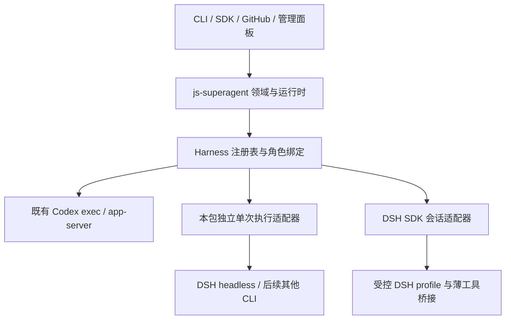

# 多 Harness 接入与 DSH 实施计划

后续计划：阶段 19–25 首期实现已由 `991b457` 提交并推送；接下来按 [dsh-superagent 工作流程对齐](workflow-alignment-plan.md) 的 W0–W6 推进，先收敛 Codex/DSH 适配器并清理旧执行路径；下文保留所有旧 Driver 的承诺属于历史目标，已由 W0 取代。此前通用 DSH 扩展阶段 27–33 撤销，原阶段 26 公共层下沉也保持撤销。本文保留阶段 19–25 的历史目标与已实现范围，不将后续计划写成已经完成。

制定及修订日期：2026-11-02（Asia/Shanghai）。状态：**通用接入层与 DSH 首期已实现，执行有限本地验收**，逐项实际结果以 [实施状态](implementation-status.md) 为准；下面保留完整目标，不将尚未实测的验收条目视为通过。本计划承接阶段 13–18，新增阶段 19–25；没有升级生产状态库或重新启用后台。按用户要求，**js-superagent 独立维护 Harness 接入层，js-agent-runtime 仅作设计参考，不引入包依赖、调用桥接、共享状态或联合发布要求**。此前的 runtime 桥接和公共层下沉方案作废。

## 1. 目标与基线

目标：新增一种 Agent harness 时，主要增加适配器、配置说明与合同测试，工单、授权、工作区、渠道、验证和交付不需要跟着修改。保留现有 CLI、SDK、Codex exec/app-server、旧自定义 Driver 和已保存会话。

| 基线 | 核对结果 |
| --- | --- |
| js-superagent | main `4b50eee`，`0.3.0-alpha.0`；源码已合并，领域内核原样复用 |
| js-agent-runtime（仅参考） | npm latest、GitHub main 包版本和本机安装均为 `0.2.2`；根项目 package.json/lock 已为 `0.2.2`。这是内容制作工具的独立依赖，不是 js-superagent 的依赖；本次未执行升级 |
| 本机 DSH | 原全局版本 `0.2.1-rc.3`；实施过程中按用户追加指令升级到 npm latest `0.2.1-rc.5`，并按安装包重核 SDK。根项目 `0.2.1-rc.2` 依赖声明保留；两者不是同一执行程序 |
| 当前后台 | 旧 0.2/schema3 的安装定义保留，服务已停止；0.3 固定包未切换；本计划保持停止 |
| 既有验收 | 沿用 [实施状态](implementation-status.md)；不补跑上轮已缩减的长时间观察或默认分支 CI |

参考：[js-agent-runtime](https://github.com/imjszhang/js-agent-runtime)、[新版变更记录](https://github.com/imjszhang/js-agent-runtime/blob/main/CHANGELOG.md)、[DSH SDK](https://github.com/deepseek-ai/deepseek-harness/blob/master/packages/sdk/client/README.md)、[DSH 协议](https://github.com/deepseek-ai/deepseek-harness/blob/master/packages/sdk/protocol/README.md)。已读本地 runtime 0.2.2 的类型、README 和实现，并核对 npm 元数据。在线 main 文档可能继续变化，不能代替固定安装包证据；阶段 19 必须固定实际 DSH/SDK 版本和对应来源提交。

### 本轮必选范围

- 中立注册表、目标配置、能力检查、统一事件、会话绑定及兼容层。
- 现有 Codex 执行端和协调者接入注册表，行为保持。
- 独立单次执行适配合同与实现；保留 Codex，并以 DSH headless 验证新增基础适配器的接入路径，不调用 js-agent-runtime。
- DSH SDK 的持久会话、修改、提问回复、取消、恢复，以及业务工具、受管理任务和协调者接入。
- CLI/SDK/面板配置、安装包兼容、针对性测试及小规模真实验收。

### 不随本轮开启的事项

不自动安装或升级用户 CLI，不自动选择 provider/模型，不扩大权限或自动切换执行端；不启动生产后台、迁移生产数据库、公开发布 npm 或自动合并 PR。飞书、固定 HTTPS、多机调度、Windows 服务和 OS 容器隔离继续暂缓。DSH 运行不加载上游 dsh-superagent 插件，避免第二套工单和收件循环。Claude Code、OpenCode 和 Cursor 的具体适配列为后续独立扩展，不因参考包新增了三者就扩大本轮 DSH 目标。

## 2. 独立架构与参考边界

| 层 | 负责 | 不负责 |
| --- | --- | --- |
| js-superagent 领域与应用 | 工单、Mandate、协调、调度、上下文、工作区、问题、后台任务/预览、验证、交付和渠道 | 解释每种 harness 的私有协议 |
| js-superagent Harness 接入层 | 目标解析、适配器注册、能力准入、角色绑定、会话引用、业务工具与原生协议转换 | 另造授权、重试或工单状态机 |
| js-superagent 内部执行基础设施 | 进程监督、启动/探测、环境和凭据注入、有界日志、事件转换与会话绑定 | 依赖外部通用运行包来解释本包的状态与配置 |
| Harness 本身 | 模型调用、原生文件/命令工具、原生会话及其事件 | 决定我们的工单已完成或远端交付可执行 |

js-agent-runtime 不在运行链路中。仅借鉴 harness/backend 分离、适配器注册、准备/探测/执行分离和严格结果判定；接口、类型、版本及测试由 js-superagent 自己维护。复用本包已有 supervisor、Driver 和业务工具，避免重写已工作的基础设施。不导入其类型/schema，不依赖其内部文件、根项目安装位置或状态目录，也不建立必须同步升级的包版本关系。

### 2.1 新版 js-agent-runtime 0.2.2 的参考价值

| 相比 0.1.0 的变化 | 借鉴方式与边界 |
| --- | --- |
| 0.2.0 增加 OpenCode V2、Cursor，内置共五类 harness | 用五类差异检验我们的注册合同；不要求一套认证、协议和权限字段适合所有执行端 |
| 原生版本/登录预检纳入总执行期限 | 本包独立实现同样原则：预检、凭据解析、握手和执行共用一个截止时间；失败不自动换身份 |
| OpenCode 通过原生导出核对结果；Claude 区分根与子任务结果；Cursor 检查 session/workspace/auth | 原生解析器分别验证完成语义，不把退出码 0 或任一子任务成功视作根任务完成 |
| Codex 凭据存储选择、Claude 认证/权限细分、代理与日志处理 | 认证、权限、平台作为明确配置组合验证；不复制用户凭据；原生配置变化仍须重查 |
| Usage、cost、实际模型未知时保持 null | 面板不把缺失统计写成 0，不用请求模型名冒充实际响应模型 |
| 0.2.1 基础 Windows；0.2.2 Cursor Windows 及 PowerShell shim | 平台能力单独声明；Windows 进程树限制与尚未真实验证的组合保留，不迁移成本包已支持声明 |
| 适配器版本变化要求重建计划 | 独立维护 adapterVersion/configRevision 与会话兼容规则，不绑定 runtime 的版本号 |

0.2.2 仍为一次非交互执行，公共接口没有持久会话恢复、实时输入或通用双向工具调用。`sessionId` 是结果字段，不能推导出 resume 能力。Cursor 对特定 bundle 的 stall-timeout preload 属于版本绑定补丁，不作为我们的通用运行机制；需要兼容补丁时必须独立核对、显式启用并限定版本。

参考实现仍存在模块全局注册表和主执行器按 adapter ID 分派部分预检/结果复核逻辑。本包采用实例级注册，并将 `preflight`、`verifyCompletion` 等原生差异留在适配器 hook 内；新增 harness 不应继续增加主运行器里的名称分支。hook 同样受取消、总时限、脱敏和进程归属约束。



## 3. 接口与状态合同

以下保留规划时的接口草案，不是最终 API。首期使用既有 execution.driver 加 backend 字段维护兼容，最终注册合同和可运行示例见 [Harness 接入](harnesses.md)。仅使用实际安装 CLI 的公开 SDK 协议，无新增 SDK 包依赖；单次与持久执行共用本包的 DSH 进程传输。

### 3.1 目标、角色和注册表

目标明确分离 harness 与 backend，借鉴参考项目的概念但独立定义 schema。一个目标还带有执行传输方式和能力要求；不能只用模型名称选择执行端。

```json
{
  "id": "dsh-worker",
  "harness": {
    "adapter": "dsh-sdk",
    "executable": "/absolute/path/to/dsh",
    "permission": "workspace-write",
    "contextMode": "project"
  },
  "backend": {
    "auth": "api-key",
    "provider": "<verified-provider>",
    "model": "<verified-model>",
    "apiKeyEnv": "DSH_WORKER_API_KEY"
  },
  "requiredCapabilities": ["sessionResume", "agentTools"]
}
```

协议、端点、推理级别及登录模式由每个适配器验证，不能把所有 harness 合并成任意字段组合。密钥只保存引用；不把运行目录、凭据值或任意 JS 模块路径写成模型可修改的配置。

注册表是每个 SDK 实例持有的对象，可注入受信任适配器；内置 ID 不允许被覆盖，运行中的适配器版本固定。不得从普通项目 JSON 自动 import 可执行插件。CLI 使用内置注册表；第三方适配器首期通过宿主 SDK 显式注册，CLI 外部插件装载另行设计。

适配器描述包含 ID、版本、支持角色、配置验证、能力声明、准备/探测，以及 Worker/Assessor 工厂。初期继续返回现有 AgentDriver/AgentDriverV2、Assessor 合同，避免为抽象重写已工作的驱动。基础适配器只需提供一次运行；高级生命周期接口按能力增补。会话、事件和工具类型与工单类型分开，便于本包独立扩展；不要求与 js-agent-runtime 的 TypeScript 类型兼容。

协调者、Worker、child job profile 分别引用目标和固定修订。可混用不同 harness；子任务仍受父派工允许的 profile、预算和权限约束，不能因目标变化扩大访问范围。

### 3.2 能力不是执行端名称的别名

有效能力为“适配器实现 ∩ 固定程序版本可用 ∩ 本次配置允许 ∩ 当前角色允许”。未知或未经核对的能力按不支持处理，不能靠提示词伪装。保存配置和运行前分别检查；版本变化使旧 probe 结果失效。

| 能力 | 独立基础适配器 | Codex 既有能力 | DSH SDK 本轮目标 |
| --- | --- | --- | --- |
| 单次修改、宿主验证、取消 | 支持 | 保持 | 支持 |
| 原生会话恢复 | 不支持，sessionId 仅审计 | 保持现有语义 | 精确恢复原会话 |
| 提问后继续 | 宿主持久化问题，新会话重建上下文 | 保持 | 宿主持久化问题，恢复原会话 |
| 运行中追加输入 | 排队至下一轮 | app-server 保持 | 由实际协议与收据核对后启用 |
| 业务工具与按需读取 | 有界快照，无调用桥接 | app-server 保持 | 薄插件桥接现有工具宿主 |
| 跨轮次任务、子任务、预览 | 不支持为父任务宿主；可作为受管子任务执行者 | 保持 | 复用 js-superagent 管理器 |
| 真实模型已读证据 | 不从终端成功推断 | 保持 | 独立映射和验证 |

基础模式是显式选择；要求原生续作、工具或预览的配置不能静默降级到 headless。缺少这些能力时，保留输入并给出具体阻断原因。

DSH 实时插话属于条件能力：若固定版本无法提供可核对的输入收据，可交付“输入排队至下一轮 + realtimeInput=false”，不阻塞本轮其余能力完成；实际配置若要求实时插话则拒绝启动。必须在最终支持矩阵写明未启用，不能称为实时输入已通过。持久会话、持久提问、业务工具和受管任务仍为本轮必选，不能按此例外降级。

### 3.3 会话、执行计划和恢复

- 保持公共 `DriverSession { driver, id }` 形状；当前实现严格验证这两个键，不能直接追加字段。增加独立、版本化的会话绑定记录，保存 adapter/version、target revision、原生状态目录、工作区身份、模型/提示词/工具版本和 lineage。
- 会话恢复先核对持久目录、工作区和配置；无效、缺失、占用、版本不兼容均明确失败，不新建会话冒充恢复。已有 Codex 会话通过兼容映射继续使用。
- 目标更新默认只影响新会话；旧会话继续固定原修订。当前授权撤销、政策与工具访问检查持续生效。跨 harness 切换走已有显式 session replace，旧记录保留，新会话仅获得有界事实包。
- 把临时执行目录与持久会话目录分开，均由本包按明确归属创建和清理。基础模式仅审计的会话记录不参与恢复；DSH SDK 的持久状态正常停止不删除。原生 CLI 支持 resume 不等于本包基础适配器已提供该能力。
- 沿用 plan/probe/run 的分离：plan 不读凭据、不联网、不执行；probe 只做明确的版本/认证状态或受控握手检查，超时有界，不运行模型。计划摘要固定可序列化配置和适配器版本，不声称冻结原生用户设置、实时项目文件或凭据值。
- 保存脱敏的有效执行配置、版本与指纹。角色权限、凭据引用、可执行程序或原生配置改变时重新核查；禁止失败后自动换 provider、身份、权限或 harness。版本/登录探测、凭据解析、启动握手和执行共享总截止时间，不能各自重新计时无限延长运行。
- 把启动前失败、已发送输入、已确认接收、已执行但结果未知分开记录；网络或 JSON 解析失败本身不授权重放。

### 3.4 进程归属、事件与工具

所有模型进程必须在外部工作开始前进入现有 owner/supervisor 管理。只有登记 PID 或调用进程组 kill 不足以证明宿主崩溃后无孤儿；沿用 guardian、代次核验和确认退出的语义。

统一事件带有 schemaVersion、runId、sequence、adapter/version、原生 session/turn/message 引用及类型。脱敏后才能进入日志、数据库或回调，未知原生事件可有界保留。区分：运输接收、进入原生历史、模型明确读取、业务确认、模型结束、宿主验证通过、工单完成。原生完成只映射执行结果；验证与交付仍由宿主决定。

业务工具继续使用 `WorkerToolHost` 与现有协调上下文接口。桥接调用绑定 session/assignment/run generation、工具版本及 call ID；验证范围、分页预算、重复调用、超时/取消与迟到结果。桥接凭据不进入提示词或普通日志。消息与模型参数不能改变工具身份。

## 4. 实施阶段

### 阶段 19：冻结兼容基线与合同（P0）

**工作：**

1. 记录本包提交、实际 DSH executable/版本、SDK 与工具桥接依赖版本、Node 要求和许可证。js-agent-runtime 0.2.2 仅记为参考资料，不作为安装前置或执行输入。
2. 核对固定 DSH 版本的 session resume、事件、启动权限、关闭进程、工具插件注册能力及 profile 组合。采用最小无模型握手/假协议验证，不把 master README 当已安装接口。
3. 核对本包现有 supervisor、早期 registerProcess/checkpoint 与各原生协议的对应关系；确定独立基础适配器和 SDK 子进程如何进入同一归属管理，不依靠外部 runtime 补生命周期。
4. 编写注册、目标、能力、事件、会话绑定和旧配置映射合同；建立一份可由测试和面板共同使用的能力矩阵。

**产物：** 合同文档、兼容清单及少量接口 fixture。**完成条件：** 不安装 DSH 的既有 Codex 用户仍可导入和初始化；基础/高级能力边界与不支持时行为可直接实现。若安装版本不满足 DSH SDK 必需合同，记录具体差异，固定可用版本后继续，不自行升级全局 CLI。

### 阶段 20：注册表与既有实现归一（P0）

**工作：**

- 新增拟议 `src/harness/{registry,targets,capabilities,events,session-bindings}.mjs` 和对应公共类型。
- 集中 `config.mjs`、`index.mjs`、`coordinator.mjs`、`runtime/jobs.mjs`、管理配置及 CLI 的执行端选择与验证。
- 将 Codex exec/app-server 和 Codex Assessor 注册为内置适配；保留 `createCodexDriver()`、`createCodexAppServerDriver()` 与已有自定义 Driver/Assessor 注入。
- 旧 driver 名称、命令参数、getConfig/getConfigV2 与旧配置保存行为保持；新增目标设置使用独立版本化入口，不强行扩张旧接口返回形状。
- 复用现有会话固定、上下文、owner、重试和调度语义；一次性提取真正重复的目标解析，暂不重写底层 Codex 协议解析。

**完成条件：** Worker、协调者和子任务均从注册表解析；受控示例适配器能通过 SDK 注册运行而不修改核心；未知目标、同 ID 覆盖、能力不匹配在模型运行前拒绝。旧会话和旧 SDK 类型消费者通过针对性回归。

### 阶段 21：独立单次执行适配层（P1）

2026-11-05：这一阶段提议的 `dsh-headless` 没有落地。当前执行端是 `dsh-sdk`；`codex`（exec）与 `dsh-headless` 只保留在迁移识别里，不能作为新配置写入。

**工作：**

- 新增拟议 `harness/cli-runner.mjs`、环境/日志与结果合同、`drivers/dsh-headless.mjs`。复用本包已有进程监督，直接调用原生 DSH CLI；准备、探测和执行接口独立实现，不 import js-agent-runtime 或复制其包内代码。
- 宿主先登记受控进程、完成启动握手，再允许原生 CLI 开始外部工作。验证父进程退出后的 CLI 后代回收；不自动启用缺少监督能力的平台。
- 独立原生解析器将完成事件、session/workspace 归属和退出结果映射为严格校验的业务报告；格式失败不自动重新执行有副作用的任务。保存原生 sessionId 仅供审计，不写成可恢复会话。
- 宿主持久化 waiting 问题；回复时将授权、最近成果、未读输入和原问题装配为新会话上下文。显示“新会话继续”，保留每次尝试的关联。
- 以既有 Codex 入口、DSH headless 和受控第三方 fixture 验证扩展合同；不将所有 harness 强制为一个进程参数模板。Claude Code、OpenCode、Cursor 的真实适配留到后续。没有动态工具、实时输入、预览能力时准确拒绝相应配置。
- 本包定义运行日志/临时状态的归属、路径重叠检查和权限，保持工作区及持久会话目录不被清理。日志有界脱敏，执行结束按归属归档；不为了放日志偷偷改变项目指令发现模式。

**完成条件：** DSH 基础目标能完成一次修改、报告、取消和新会话回复；CLI 终端失败/缺少 final/非零退出不误报成功；宿主崩溃和超时不留下受控进程；认证/配置拒绝不触发模型。独立安装中没有 js-agent-runtime 仍可运行。真实 provider 验收与阶段 25 合并，不对未来适配器预先跑远端全链路。

### 阶段 22：DSH SDK 持久会话执行端（P0）

**工作：**

- 新增拟议 `drivers/dsh-sdk.mjs`、DSH 配置检查及监督适配，使用官方 SDK 或其公开协议；选择版本和传输后固定，不维护两个等价传输实现。
- 每个活动 Worker/协调角色使用独立受控 DSH 进程，按会话持有专用 profile/home，独占锁与现有 owner 代次结合。首期不跨并发 Worker 共享 DSH 进程。
- 优先显式 API backend；模型路由与端点按实际 provider 插件验证。用户原生登录只有在精确隔离与恢复行为已验证时再列支持；参考包的 API-only 限制不能被写成 DSH SDK 的全部能力。
- 只加载固定所需的 bundle、provider 和工具；禁止未声明的插件安装、继承集成、原生 goals/workflows/自主调度和子 Agent 绕过宿主。项目指令与技能遵循显式 contextMode/允许根目录；权限由原生机制实际施加，不能只靠提示词。不得把隔离 HOME 的认证模式静默改成用户全局模式。
- 在发送首个有副作用输入前保存原生会话身份及绑定。核对 session cwd 与 worktree/copy 路径；恢复必须使用原状态目录，拒绝占用、错目录和不兼容会话。
- 采用 literal prompt 路径发送外部文本，避免 `/...` 消息被解释为原生权限/goal 命令；核对技能识别等仍可能存在的原生入口。
- SDK 的原生 idle、finalResponse 与输入无一一因果保证，按该次活动的 session/turn/输入收据关联处理，不能拿最后一条文本替代报告校验。
- 取消通过关闭该 Worker 的受控进程并等待退出；不能影响另一 Worker。异常中断保留事实，按现有显式恢复策略重新打开原会话。

**提问策略：** 以业务报告/桥接工具的 waiting+attention 为标准。原生 ask-user 工具在此 profile 禁用或替换，避免留有无法持久恢复的 RPC 等待。若出现未预期原生问题，记录待处理问题并安全结束本轮，不自动回答；下轮以宿主持久问题/回复恢复，不能把旧 requestId 当重启后的有效句柄。

**完成条件：** 一个隔离 DSH 工单完成修改、宿主验证、提问回复、取消及原会话恢复；并发取消不互相影响；关闭与超时等待实际退出。基础版本无桥接时不宣称 agentTools/managedJobs 已支持。

### 阶段 23：DSH 工具桥接、协调者与受管任务（P1，本轮必选）

**工作：**

- 若固定 SDK 不能直接注册业务工具，实现一个最小 DSH companion plugin；仅负责工具协议转换，无数据库、工单、渠道或自主执行循环。插件文件和 manifest 随安装包分发并固定版本，不由模型临时安装。
- 桥接优先私有进程通道；若需 loopback RPC，使用短期运行凭据、固定方法、严格长度/超时与当前代次核验，不监听公网。具体通道在阶段 19 的插件接口核对后确定。
- Worker 暴露读取、ack、handback、上下文订阅、报告及受控 jobs；协调者只获得候选及允许的来源读取/路由接口，不获得 Worker shell 或任意文件修改能力。所有决策仍经 validateAssessment/applyAssessment 重新检查当前政策。
- 实时输入建立 durable inputId→原生 message/turn 的映射；投递未知时先查询/核对，不能无条件重投。只有可证明消费并有有效后续报告/结束证据才调用 inputRead；不支持精确映射时保持下一轮投递，并按第 3.2 节将该条件能力标为未启用。
- 复用现有 ManagedJobs、预览租约、父快照、成果采纳与 journal；DSH 原生自由子 Agent/后台守护进程不成为第二套调度。原生普通 shell 生命周期由 DSH 管理，跨轮次持久命令必须使用宿主管理接口。
- 配置协调者和 child profile 的独立目标；混合 harness 的子任务结果仍按相同权限和采纳规则处理。

**完成条件：** DSH 模型能按需读上下文、退回错误输入并经协调者重新路由，能调用一个受管子任务并由宿主采纳/验证；预览结束本轮仍可供审阅、释放槽位、关闭后回收。这些场景合并在有限的本地验收内；不能只因注册工具成功就声明通过。

### 阶段 24：配置、迁移与使用入口（P1）

**工作：**

- 在 CLI 增加 harness 列表、目标配置与 doctor/probe 入口；现有 run/serve/reply/retry 等业务命令不变。CLI 与面板使用同一目标解析和能力结果，不各自推断支持性。
- 面板展示角色目标、实际模型、认证方式（仅类型/引用）、原生续作/上下文重建、能力限制及阻断原因；保存使用现有 expectedRevision 和草稿保护。
- 新配置 schema 和会话绑定记录设计显式迁移。先核对是否需 DB schema bump；只要旧二进制会误读新语义就必须提高版本并拒绝旧包打开，不能因使用 meta 表就省略版本保护。
- 测试 schema4 到新版本及旧 schema3 的串联升级路径，只在隔离副本执行；记录配置/会话映射，保留一致性备份及旧包。回退核对外部动作后恢复匹配备份，禁止仅降级安装包。
- 保留旧配置读取和已有 Driver exports；新增字段不自动改写旧会话或切换目标。旧配置中的 codex 路径、模型、提示词、并发、交付和政策保留。
- DSH 官方 SDK 按需加载；包内显式声明必要的可选依赖/peer 范围与安装方式，不能依赖仓库根 node_modules 偶然存在。不得添加 js-agent-runtime 的普通、可选、peer、开发或间接桥接依赖。仅用 Codex 时不要求 DSH；导入 SDK 不下载 CLI、不初始化 DSH profile。
- Node 支持按组合声明：js-superagent 的现有下限保持；DSH 组合使用固定 DSH 包实际 engines，不因接入 DSH 就默认提高所有用户的下限。

**完成条件：** 在无 js-agent-runtime 的干净临时目录安装包，旧 CLI/SDK 及新 DSH 配置可用；检查包声明、锁文件和 import 无 runtime 依赖。未安装 DSH SDK 等实际可选依赖能正常使用 Codex，选择对应适配器时给出准确安装指引；一个普通目录与一个 Git worktree 可配置新目标。一次面板配置操作覆盖保存、能力拒绝与原生会话信息显示。根项目现有内容制作对 js-agent-runtime 的依赖保持原样，不为证明独立性而删除它。

### 阶段 25：有限验收与交付（P0 收口）

**自动检查范围：** 运行新增合同、受影响的配置/会话/调度/工具/迁移回归、公共类型消费者和包安装检查。保留上游 core 来源完整性检查。若内核未改且未发现相关回归，不为新增适配器重复整套真实模型/远端验收。只读文档阶段只检查文档和索引。

**实际验收合并为以下小组：**

| 验收组 | 内容 | 边界 |
| --- | --- | --- |
| A 既有 Codex | 一次小任务验证注册表迁移后仍能修改、验证、回复续作 | 不重新跑上轮全部故障矩阵 |
| B 独立基础执行 | DSH headless：修改、waiting、回复后新会话继续；另用受控进程验证取消 | 无 js-agent-runtime 参与；不把 headless 结果冒称 SDK 验收 |
| C DSH SDK 本地 | 同一验收项目分段验证修改、问题回复、原生恢复、取消；增加工具读取/退回、一个受管子任务及宿主采纳验证、预览租约与清理 | 本组可包含多个短工单，不要求长时间空轮询；若启用实时输入，用明确原生收据核对，否则验证排队下一轮且能力为 false |
| D GitHub | 在已有专用验收仓库，用 DSH Worker 完成一次 Issue→修改→宿主验证→draft PR→一条反馈修复→App 回传 | 不制造默认分支故障，不自动合并；仅清理本次对象 |
| E 兼容/安装 | 旧配置/Driver、隔离迁移/回退、可选依赖缺失、外部示例适配器、面板配置、无 runtime 依赖的独立安装 | 协议和隔离测试，不启动生产服务 |

同包证据记录源码/包摘要、适配器/CLI/SDK 版本、Node、目标修订、工单/会话映射、输出验证和清理。不把假协议、真实 CLI+mock provider、真实 provider 三种证据混写。后续修复只重跑受影响组，不为了凑时长或轮询数延长验收。

缺少模型凭据时先完成代码与协议/安装检查，再请求凭据的环境变量名或配置路径；不索取明文、不切换其他账号冒充通过。GitHub 实际执行沿用明确授权的测试仓库和 App 范围；运行前核对该次测试对象、身份和分支，生产后台保持停止。

**交付：** 更新 README、运行合同、适配器开发说明、支持矩阵和实施状态；提供固定候选包及最短配置示例。版本拟为下一 alpha，冻结时确定。未实际通过的组合单列限制。生产升级、启用 DSH 为默认执行端、npm 发布不纳入默认动作。

## 5. 测试重点与停止规则

测试针对合同风险，不机械复制每个适配器全部测试：

- 旧 Driver v1/v2 和已有会话不退化；来源内核保持原样。
- adapter/target/version 不匹配、原生会话缺失或 cwd 不符时，零模型启动、零静默替换。
- 取消、超时、宿主崩溃、子进程失联：归属可查、迟到回调无效、未确认退出不能开替代 owner。
- 运输回执不等于已读；重复/乱序事件、报告冲突、输出截断和终端缺失不能导致误完成。
- 工具重复调用、跨工单、旧代次、授权撤销和关闭后的调用均拒绝；模型不能获得渠道凭据或通用宿主 SDK。
- 显式只读/工作区写权限不因适配器失败提升；配置隔离效果核对，不以目录副本充当 OS 隔离。
- SDK 导入不启动程序；probe 不调用模型；能力失败不通过重复执行“修好”；credential resolver 的错误与日志不泄露密钥。

针对性回归通过且对应实际链路通过后停止扩测。发现新缺陷才增加其复现用例和受影响重验；无新增证据不重复大规模测试。任何阶段不能将“已实现”写成“已部署”。

## 6. 后续扩展与独立性约束

原阶段 26“公共层下沉到 js-agent-runtime”已撤销，不再列为实施阶段或架构目标。两个项目独立演进，任何一方升级、移除或不安装都不应迫使另一方修改。

- Claude Code、OpenCode、Cursor 后续分别实现本包适配器。每次只增加对应协议、配置、能力描述和合同测试，不修改领域内核；不预先承诺所有平台或原生能力。
- 单次与会话型执行可共用本包的监督、环境、事件和日志基础设施，但不会为了复用而降低旧驱动的恢复合同。
- 第三方宿主通过本包公开 SDK 注册适配器；注册接口不要求 js-agent-runtime 类型或其注册表存在。未来是否另建任何共享包需重新作架构决定，不在本计划默认发生。
- 参考新版只更新设计判断，不自动追随其发布、内部补丁、平台声明或依赖安装。原生 harness 官方协议才是各适配器的实际实现依据。

## 7. 顺序、提交和完成判定

执行顺序为 **19 → 20 → 21 → 22 → 23 → 24 → 25**。阶段 19 可并行核对 SDK 协议与旧合同；阶段 24 的界面草案可提前准备，但保存/迁移必须等合同稳定。后续更多 harness 按独立适配器安排，不引入公共运行包迁移前置。

建议提交单元：合同与兼容 fixture；注册表及 Codex 归一；独立 CLI 适配与进程监督；DSH 基础会话；业务工具与协调者；配置/迁移/面板；固定包与验收文档。每个提交均保持旧入口可运行，不在这轮顺带重构领域内核。

| 阶段 | 当前状态 | 主要产物 |
| --- | --- | --- |
| 19 | 首期完成 | 固定 rc.5 的本机 SDK 协议、能力与配置合同 |
| 20 | 已实现 | 实例注册表、旧入口兼容和 Codex 映射；Worker/Child/Assessor 工厂归一 |
| 21 | 已实现 | 独立 DSH 进程传输与 headless；没有 js-agent-runtime 依赖 |
| 22 | 已实现 | SDK 持久会话、严格终态/输入关联、取消与恢复；实时插话暂不声明 |
| 23 | 已实现，有限验证 | 薄工具插件、只读协调者及复用宿主受管任务；完整子成果/预览真实组合未重新验收 |
| 24 | 已实现 | CLI/SDK/面板目录及配置，schema5 迁移与会话绑定 |
| 25 | 按本轮范围收口 | 针对性回归与少量本地真实 DSH；没有重跑 DSH GitHub 全链路或大规模测试 |

本轮完成需能回答：新 harness 如何注册；哪些能力可用及为何不可用；旧任务如何继续；如何取消且不留所属进程；提问如何跨重启保存；未知外部副作用如何避免重放；实际测了哪些版本/组合。生产后台继续停止，不以本轮完成作为重新启动授权。
