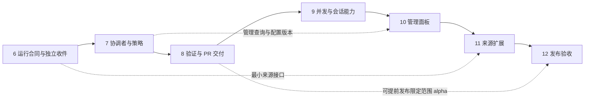

# js-superagent 后续实施计划

制定日期：2026-11-01。状态：**阶段 6–12 已开展实施；当前结果与逐项证据见 [实施状态](implementation-status.md)**。

后续阶段 13–18 见 [上游对齐与持续运行实施计划](alignment-plan.md)。本文保留阶段 6–12 启动时的基线、限制和原验收门槛，不作为当前能力清单。

本计划承接阶段 1–5，按“运行时 → 协调决策 → 交付 → 并发 → 管理与渠道”的顺序补齐上游公开原型的主要能力，同时保留独立 npm 包、CLI／SDK 和非 DSH 执行端的定位。本文件保留原实施范围与验收门槛；实际公开合同见 [运行时 v2](runtime-v2.md)。未完成真实验收的子项不会因代码存在而标为完成。

## 1. 基线、目标与完成定义

- 本包基线：`49234b4`；上游基线：`6337fc823ce20251c8de8085948165c81aaa701e`。
- 已完成：原样领域内核、独立 SQLite／Effects／Outbox、Codex 执行、工作区隔离、GitHub Issue／显式关联 PR／CI、App／Webhook、macOS 后台服务和真实自身代码修改验收。
- 当前限制：项目内单执行槽；默认来源同步会等待执行完成；无真实 Assessor；报告仅接通简化子集；PR 交付和完结尚未完整接通；没有管理面板、飞书及系统管理的 Worker 后台任务。
- 自身代码验收中，Worker 完成修改并提出验证问题，宿主补跑完整测试、采纳、提交和推送。这是已验证的协作流程，尚不是系统独立交付 PR 的证据。见 [验收记录](phase5-self-host-acceptance.json)。

目标使用流程：允许的人发起请求 → 系统判断归属与授权 → 建立或续作工单 → 在独立工作区执行与验证 → 按授权交付 PR 或本地成果 → 跟进审阅／CI → 达到完结条件。过程中可以回答问题、暂停、取消和恢复，所有动作可追溯。

阶段完成须同时满足实现、兼容检查、故障恢复测试和对应真实验收。只完成接口、模拟测试或演示，不记为对应真实能力已完成。发布版本应列明实际支持的执行端、系统和权限条件。

## 2. 贯穿各阶段的约束

1. **保持独立。** 核心与默认运行时不依赖 DSH；DSH 若接入，应为可选 Driver。
2. **保留入口。** 现有 CLI 命令、SDK 调用、工单 ID、会话和工作区继续可用。旧字段、枚举与行为的兼容性要有消费者测试，不能仅凭“字段增加了”判断兼容。
3. **区分建议与授权。** 模型提出研判和动作建议；程序检查来源、当前政策和工单授权后才执行。消息正文不能改写政策或扩张仓库权限。
4. **先保存意图，再执行外部动作。** 模型调用、输入投递、验证、提交／推送、PR 与回传均有持久记录和稳定标识。恢复时核对外部事实，不盲目重放。
5. **明确暂停与停止。** 业务暂停继续接收并保存事件；服务停止结束调度并按现有规则停止执行。两者不能互相替代。
6. **默认保留显式恢复。** 已开始的任意外部操作被中断后，默认要求检查后重试。只有具备可核对结果的受控动作可以自动恢复；自动恢复策略必须单独配置和验收。
7. **保护内核来源记录。** 优先接通已有 Engine 方法。在适配层无法正确表达时，再单独记录核心变更理由、上游差异、许可和测试；不在无说明下改写提取校验值。
8. **隔离声明要准确。** worktree／副本是文件工作区，不等于 OS 隔离。更宽的测试或交付能力通过明确执行环境和权限配置提供，不默认放宽所有 Worker 权限。
9. **现有运行服务与源码分开升级。** 当前服务绑定固定安装包。修改源码不会更新该服务；每次部署必须有包版本／摘要、迁移、切换与回退记录。

## 3. 阶段和依赖

| 阶段 | 主要交付 | 完成门槛 |
|---|---|---|
| 6. 可靠收件与运行合同 | 独立来源循环、完整报告、业务暂停、兼容层、迁移设施 | 长任务期间正常收件；暂停、取消、崩溃无丢失／重复执行 |
| 7. 协调者与策略 | 真实 Assessor、路由工具、规则与版本、上下文读取、角色配置 | 真实请求可接单／归入／退回／忽略；模型不能绕过授权 |
| 8. 验证与 PR 交付 | 受控验证、交付动作、自动关联、head 跟踪、审阅完结 | Issue → 修改 → 验证 → PR → 审阅修复 → 完结的真实闭环 |
| 9. 并发与会话能力 | 多 Worker、优先级、实时输入、受管理后台任务／子 Agent | 并发不串任务；能力支持有真实证据；不支持的端明确降级 |
| 10. 管理与可观测性 | 管理 API、面板、健康状态、提示词与设置编辑 | 人能从界面处理待办、解释状态并控制任务 |
| 11. 来源扩展 | 仓库级 GitHub 入口、飞书、统一上下文与身份处理 | 跨来源接单／续作／回传／恢复真实通过 |
| 12. 分发与部署完善 | 安装升级、系统支持矩阵、备份恢复、发布检查 | 新环境可按文档安装和回退，发布包无本地状态及秘密 |

图中实线是建议实施顺序，不表示面板或飞书必须等待全部执行端高级能力。9b／9c、11b 可在各自前置合同稳定后并行推进；缺少真实执行端或外部账号时应明确标为待验收，不阻塞已验收子集的发布。

## 4. 阶段 6：可靠收件、报告与暂停

### 6a. 分离来源、执行与回传

将 `ProjectRuntime` 中目前串行的同步／执行周期拆为独立职责；`src/index.mjs` 继续作为兼容入口和组装点。拟议模块为 `runtime/ingress.mjs`、`scheduler.mjs`、`control.mjs`、`projection.mjs`，具体拆文件数量服从实现需要。

- 来源循环持续轮询及处理 Webhook 核对队列；Worker 忙碌不阻塞收件。
- 来源 I/O 在事务外完成，规范化事件、去重、游标和领域接收在短事务内保存。
- 建立最小 Source 合同：来源身份、poll／receive、投递、上下文读取、游标和健康状态。先适配 local／GitHub；阶段 11 扩展实现。
- 队列区分协调、执行、控制和回传；单项网络或模型等待不占用整个调度循环。
- 跨进程仍保持有效所有者唯一，使用领取代次／令牌和可恢复租约拒绝迟到回调。迁移旧的全项目 execution 占用时保持单槽行为。
- 对长轮询采用合并唤醒和有界重试；忙碌期间到达的事件保存为待处理输入，不冒充已经被模型读取。
- 取消和授权撤销通过控制通道及时生效，不排在长任务后。远端取消必须来自允许身份，且命中明确工单；自由文本不能绕过控制命令的授权校验。

保留 `runNext()` 的“一次至多启动一轮 Driver”语义；`start()` 负责独立循环，`stop()` 等待各循环和执行者退出。`syncGitHub()` 仍可用于无模型调用的显式同步。

### 6b. 报告版本、能力声明与业务暂停

- 保留现有 Driver v1 的 `completed`／`waiting` 合同及旧 `TicketStatus` 类型，不直接扩大导出枚举导致调用者的穷尽分支失效。
- 增加显式 v2 报告与详细工单视图，接通核心的 `progress`、`waiting`、`ready`、`blocked`、`failed`、`dropped`，并以独立 Attention 表达问题。
- 旧 `waiting` 仍按现有“需要回答”处理；v2 的“等待事件”和“等待人回答”必须区分。PR 未结束时的 `ready` 展示为待审，不宣称工单已完结。
- 详细视图增加 stage、outcome、attention、delivery／verification 状态；旧 `get/list/status` 保留既有投影。实施前固定映射表并用旧包消费者编译与行为测试验证。
- 在此阶段定义 Driver 能力声明：结构化进展、会话恢复、实时输入及读取确认、后台任务、子 Agent。未声明能力的旧 Driver 按 v1 单轮执行处理，不能调用不存在的能力。
- 新增拟议 `pause`／`resume` 与 SDK 对应方法。暂停继续收件和持久化，不启动新评估／派工、不投递普通输入、不发送业务 Outbox；已运行轮次可以完成并保存结果。取消仍有效；本地控制命令立即返回自身结果。
- 暂停状态持久化，恢复时重新核对当前授权、PR head 和已过期的输入。服务重启不能偷偷解除业务暂停或执行中断保护。
- 暂停会阻止新的业务发送领取，但已发起的网络写入不能保证撤回；成功的外部写入仍须保存真实收据。移除当前同步函数隐含的无条件回传路径，避免暂停只停 Worker 却继续发消息。
- Driver／模型瞬时错误与普通任务失败分开记录。仅在执行端可证明没有开始外部动作或能够核对结果时自动重试；否则要求显式恢复。

### 6c. 通用迁移与配置设施

当前数据库和项目配置均为 v2，但版本含义独立。为后续阶段提供顺序迁移器、迁移日志和可验证备份；不把所有新功能一次塞进一份未经使用的最终 schema。

兼容方案还必须覆盖公开 `ProjectConfig` 中的版本和 `concurrency: 1` 字面量：新配置／报告合同使用显式版本化类型与入口。原入口保留默认单槽的可表达行为；遇到旧合同无法表达的新配置时明确要求使用新版接口，不能返回虚假的并发值或悄悄改变类型。旧配置升级不得自动开启主动接单、更多并发或更宽权限。

升级须先停止服务并确认没有活动所有者，再做 SQLite 一致性备份和完整性检查。旧二进制拒绝打开更高版本数据库；回退需要旧包和相配的升级前备份。恢复备份前还要处理升级后已发生的远端动作，不能靠旧游标重新执行。

**验收门槛：**

1. 真实 Worker 运行至少 180 秒；轮询配置为 30 秒，执行期间确认至少四次成功同步，后续反馈在正常网络下于两个轮询周期加 5 秒内落库。这是受控验收指标，不是公网 SLA。
2. 同一事件经轮询、Webhook、重投同时到达，只产生一份有效输入；落库后杀进程仍可接续。
3. 暂停时收件成功但不启动新 Worker／发送业务回传；恢复后重新校验并执行一次。
4. 活动 Worker 可被取消；旧进程的迟到报告不能覆盖重试后的派工。
5. v1 Driver、旧 CLI／SDK 消费者、v2 状态映射、迁移失败回滚与旧包拒绝降级全部通过。

阶段 6 只保证及时收件和排队；向正在执行的模型轮次实时插入消息属于 9b。

## 5. 阶段 7：协调者、策略与上下文

### 7a. 接入真实协调者

- 在独立适配层实现 `Assessor`，由持久化协调会话处理候选。定义与执行 Driver 分离的协调端接口及 router／worker 模型配置。
- 协调者输出接单、附加到现有工单、停止、忽略或无法判断的结构化建议；程序验证当前 Eval、来源和权限后调用 Engine。
- 接通 `attach`、`handback`、`followForContext`、`note` 等已有内核能力：Worker 可以退回不属于自己的请求，纯上下文订阅不能授予执行权。
- 初期主协调者不直接改代码、不持有交付凭据。它只使用经过范围限制的查询和路由工具。
- 模型调用前保存候选、策略版本、上下文引用和请求标识；返回后检查代次。取消或政策更新后的旧回答不能继续接单。

### 7b. 策略与角色配置

- 将当前写死 Policy 替换为可版本化的配置，包含允许身份、来源准入、机器人候选、工作规则和主动模式。
- 明确命令接单保留兼容路径；主动模式默认 `off`。`observe` 只记录研判和 would-accept，不启动 Worker；`auto` 仅适用于明确启用的规则和来源范围。
- 明确配置变更的权限与影响：政策由可信本地操作／管理入口修改；消息正文不能改规则。变更时重新校验待执行动作，并向受影响工单传递政策变化。
- 协调和 Worker 分别记录模型、提示词版本、工具能力、时间／调用预算和结果；预算耗尽转为可解释的等待，不无限重试。
- 已有会话固定其创建时的模型及有效提示词版本；设置变更对新会话生效，或通过明确的会话迁移处理，并保留变更记录，不能静默改换正在恢复的会话。
- 阶段 7 即保存配置／策略／提示词最小版本历史与并发修订号；阶段 10 提供编辑和比较界面。

### 7c. 按需上下文

- 提供分页读取工单、话题、决策、输入和原始来源的只读资源工具，附 stable ID、版本、来源及游标。
- 初始上下文使用有界摘要和引用；完整历史可按需读取，不再无界重复拼接所有消息。
- 摘要标明覆盖范围、来源版本与遗漏项；新事实出现后能失效／重建，不能把模型摘要当授权事实。
- 来源文本、代码评论和附件属于任务数据；角色指令、团队政策与工具权限由宿主独立装配。

**真实验收矩阵：**

| 请求 | 预期结果 |
|---|---|
| 新的明确委托 | 一个新工单，记录授权与决策依据 |
| 对已有工作补充细节 | 进入原工单，不重复建立任务 |
| 在旧讨论提出无关工作 | 退回协调判断，建立独立授权或提出澄清 |
| 未授权账号或正文要求扩大权限 | 不启动执行；记录程序拒绝原因 |
| 匹配规则的主动候选 | off／observe／auto 分别产生预期行为 |
| 政策更新期间旧模型回答返回 | 旧回答失效，不使用旧授权执行 |
| 长话题或跨话题上下文 | 分页读取正确；context-only 输入不能自行唤醒已结束任务 |

模型不确定时允许提出澄清或返回 unavailable，不要求它对含糊文本强行作出确定判断。真实模型验收与稳定的协议／权限回归测试分别记录。

## 6. 阶段 8：受控验证和完整 PR 交付

这是在上游交付流程基础上的独立化实现；其中结构化的验证结果通道是本项目增强，不应描述为已从上游移植的独立验证器。

### 8a. 准备与验证执行环境

- 提供项目级 prepare／verify 配置，指定命令、工作目录、依赖安装方式、超时、资源与网络条件。配置由可信操作者保存，Worker 不能通过报告直接要求任意宿主命令。
- 保留当前收敛的 Worker 权限。需要本地监听、网络或特定工具的测试，在显式配置的验证环境中运行，例如隔离容器或受管理验证进程。
- 验证环境的限制由实际 OS／容器能力实施；命令列表和路径检查不能冒充完整隔离。没有适合的环境时返回“验证条件不足”，不能谎报测试失败或通过。
- 验证记录包含命令、配置版本、开始／结束时间、退出码、日志引用、代码与测试树摘要。代码在验证后改变时，相关验证结果失效。
- Driver 的自然语言报告和宿主捕获的验证事实分开保存；变更路径存在、测试是否真的运行，以及是否覆盖当前修订可以独立检查。

### 8b. 交付动作与权限

- 在宿主实现交付服务，独立处理生成 diff、提交、推送和创建／更新 PR。保留旧 Driver 不提交的默认行为；v2 Worker 请求交付，由程序检查后执行。
- 配置交付模式：本地成果、允许创建草稿 PR、允许更新本工单拥有的 PR。自动合并默认关闭，单独作为明确授权与分支规则控制的可选能力。
- 当前 App 不能据此直接推送或开 PR。启用远端交付前，要完成对应仓库的 Contents 写和 Pull requests 写权限配置及安装核对；需要改 workflow 等额外范围时另行明确授权。
- 交付凭据由交付服务持有，不交给普通 Worker。允许的仓库、文件范围、分支归属、基线 SHA、目标分支和交付方式都需可核对。
- 默认只推送本工单拥有的分支，不直接写受保护分支、不覆盖无归属的分支、不自动强推。外部修改或非快进冲突进入待处理状态。
- 保存 commit SHA、预期远端 head、PR 标识和稳定交付标记。模拟“远端成功但本地未记账”后，能通过核对恢复，不重复创建 PR。

### 8c. PR 与工单生命周期

- 接通 Engine 的 `bindThread`／`threadClosed`。自建 PR 与显式跟进的 PR 区分归属，支持一个工单多个 PR 的完结条件。
- 受控推送成功后自动更新本工单 PR 的可信 head 并废弃旧 CI／审阅输入；其他人改变 head 时停止自动推进，先重新判断基线与授权。
- PR 打开且报告 ready 时进入待审；审阅要求修改时续作；合并／关闭后按核心条件结束工单。有未处理的人类反馈时不能提前完结。
- 只凭类似分支名不能取得归属；自动发现需核对身份、项目／工单标识、仓库与已保存交付记录。
- 本地成果模式继续可用，普通目录项目不强制 GitHub 或 PR。

**验收门槛：**从安装包发起真实 Issue → Worker 修改包代码 → 受控环境执行涉及本地端口的测试 → 创建草稿 PR → 人类审阅／CI 触发原工单修复 → 新 head 验证通过 → 经明确授权合并或关闭 → 工单按实际结果完结。全程无需宿主手工复制 diff、拼接提交或替 Agent 伪造验证结果。

另需验证：推送／PR 创建前后各崩溃一次、重复反馈、外部 head 改动、失败验证、权限撤销、分支冲突和一个工单多个 PR。未经授权的合并不能作为验收步骤默认执行。

## 7. 阶段 9：多 Worker 与高级会话能力

### 9a. 多工单调度

- 将全项目唯一执行占用迁为按工单／派工的占用，并保留项目级容量控制。默认并发仍为 1；配置迁移后才能显式提高。
- `in-place` 必须保持单执行槽；并发只能用于已核对互不共享写目录的 worktree／副本，或明确证明隔离能力的自定义执行端。
- 提供 maxWorkers、准备任务容量和有界人工反馈优先槽位；同一工单始终只允许一个活跃执行者，兼顾公平性，避免新任务或持续人工输入饿死其他任务。
- 来源、协调、验证、交付分别有容量和预算；Git 写操作按仓库／分支串行化，不因 Worker 并发而竞争同一分支。
- 更新状态视图，解释排队原因、持有槽位的任务和等待的人。一个 Worker 失败不导致其他工单被重复执行或取消。

**真实验收：**同项目三个独立任务同时执行并使用不同工作区；过程中人工反馈得到有界优先处理；一个进程中断后其余任务继续。重启后不会为仍存活的执行者另开重复实例；原地模式的非法并发配置被拒绝。

### 9b. 执行中输入与读取确认

先做执行端可行性验证，确认真实端是否提供会话事件、输入投递、消费确认及取消能力，再选用相应协议实现。不能假定现有 `codex exec` 已提供全部能力。

- 对声明支持的执行端增加输入 ID、投递代次、读取确认、进展事件及控制通道；只有明确消费证据才能标记已读。
- 对不支持的执行端继续使用下一轮输入，并在 CLI／面板显示能力限制；不靠杀掉重启伪装成实时插话。
- 没有原生会话恢复能力的 Driver 可以基于工作区和审计摘要建立新会话，但必须标明这是上下文重建，不能宣称恢复了原 Session。
- 在读入、处理、报告各时间边界注入崩溃，核对未读输入补投、已处理输入去重、取消后迟到事件拒绝。

**验收门槛：**至少一个真实非 DSH 端在任务进行中接收新要求，于下一可用模型步骤处理，保持原会话、工单和授权。若只有接口与替身测试，9b 必须继续标为未完成，不得宣称能力对齐。

### 9c. 后台工具与子 Agent

- 基于已验收能力定义任务所有权、进程树、子任务 ID、完成事件和恢复记录；限定在父工单的权限与范围内。
- 管理后台工作持有／释放槽位、结果唤醒、最长等待、人工交接、取消和父派工结束后的退出。
- 参考上游默认 30 分钟的等待上限，但做成明确配置；保留给人审阅的服务进程须有归属、到期和关闭入口。
- 子 Agent 包括嵌套子任务，必须受预算和停止传播约束；不得把孤儿后台进程留给操作者猜测。

**真实验收：**后台测试和子 Agent 各自完成后唤醒正确 Worker；人工交接正确释放槽位；取消／超时／父进程崩溃清理归属内资源，且不触碰其他任务或用户进程。

## 8. 阶段 10：管理 API、面板与可观测性

先形成稳定的管理查询／命令服务，再构建界面。复用阶段 6／7 的领域与版本合同，不另建一套状态逻辑。

- 默认仅本机可访问的管理 API，提供来源、工单、决策、派工、验证、交付、健康状态、暂停／恢复／取消／重试和配置操作。
- 对写操作实施身份验证、Origin／CSRF 防护、修订冲突检查与审计。远程访问是另行配置的部署能力，不自动随面板启用。
- 面板先回答“什么需要我处理”，再显示任务、来源、决策历史和系统状态；支持按工单、Issue／PR、事件 ID 检索。
- 显示进程状态与业务健康的区别：最近成功同步、事件积压年龄、Worker 进展、失败回传、验证环境及凭据可用性。
- 健康异常按持续时间／连续失败和恢复状态聚合；通知仅在有意义的变化或需要处理时发出，避免每轮重复提醒。
- 编辑团队提示词、角色模型、策略和来源设置；提供历史版本、默认升级差异、恢复以及当前会话所用版本。变更触发阶段 7 的影响分析。
- 诊断导出过滤秘密、敏感环境、原始私密载荷和无关日志；保留排障所需的事件关联与错误类别。

**真实验收：**从界面处理一次 Agent 提问、一次失败重试、一次业务暂停、一次权限变更和一次交付审阅；第二客户端的过期设置保存被拒绝；出现“进程存在但同步失败”时界面能准确说明问题。正常时不产生重复警报。

## 9. 阶段 11：GitHub 覆盖与飞书来源

### 11a. GitHub 来源范围

- 基于阶段 6 的 Source 合同支持新 PR 直接接单、仓库级 Issue／PR／评论观察及默认分支 CI 候选，默认关闭主动观察。
- 为流和话题分别保存游标、读取错误与补收位置；单个话题失败不能长期阻塞其他来源。
- GitHub App 与通知账号模式分别走其支持的 API；不能把 App 当作具备个人通知收件箱的账号。
- 新入口统一经过阶段 7 政策；初始历史建立基线，不把所有旧事件突然当成新任务。
- fork PR 的执行与交付作为独立可选子项，先明确不可信代码、凭据隔离和回传策略；不计入同仓库闭环的完成条件。

### 11b. 飞书与跨来源上下文

- 接入 bot 的实时事件、订阅话题轮询与历史补收，支持明确配置的群、私聊及 mentions／all 模式。
- 保存稳定消息 ID 和读取游标，核对 sender、群范围和机器人身份；支持回复原话题和必要的图片／附件上下文。
- 可选成员同步更新政策版本；不能仅因不同渠道显示名相同就认作同一人。
- 跨渠道关联通过明确操作或有依据的协调建议建立，保留来源和授权区别；一个渠道的新内容不能继承另一个渠道未授予的权限。

**真实验收：**飞书发起任务 → 原话题回答问题 → 在 GitHub 产生关联 PR → 审阅续作 → 完结结果回到正确渠道；断连后补收不重复，成员撤销后旧授权失效。没有实际可用的 bot、群和授权时，11b 只能交付代码与本地测试，真实验收保持未完成。

## 10. 阶段 12：分发、部署与可选扩展

这些是独立包产品化工作，不全部属于上游已经实现的能力。按目标环境选择发布范围，不要求为发布第一个可用版本同时支持所有平台。

- 建立 Node 最低声明版本与当前稳定环境的 CI／安装测试；如实际能力不支持声明下限，应在发布前明确调整 engines。
- 验证 tarball 的 CLI、SDK、类型、许可、静态资源与依赖；排除凭据、数据库、任务工作区、原始日志和测试运行成品。
- 在普通 Python 目录及 Git 仓库从零安装，配置执行端、轮询、服务、升级与恢复，不能依赖开发仓库已有 node_modules。
- 发布前核对包名、版本策略、许可证选择、变更记录和实际支持矩阵。`npm pack` 验收不等于已发布；真正发布按用户明确指令执行。
- 完善 macOS 登录／整机重启实测；按需增加 Linux systemd。Windows 需单独验证进程监督和路径行为，不以能运行部分 SDK 推断完整支持。
- 轮询继续作为无需入站公网的默认路径。固定 HTTPS 仅在采用 Webhook 的环境部署，验收真实投递、重启后地址不变、签名验证与轮询补漏。
- 备份恢复、日志保留、结束工单的工作区归档／清理提供预览与归属检查；清理不能删除未交付的成果或仍被任务使用的资源。
- MCP、其他 Driver、集中多项目及分布式执行单独立项。前两项可复用管理／Driver 合同；分布式需重新设计所有权和存储，不属于本计划的单机对标完成条件。

## 11. 每阶段的交付和升级流程

1. 固定该子阶段范围、合同和接受条件，保存一份当前已安装版本及状态基线。
2. 在隔离开发环境实现；优先验证真实行为边界和故障恢复，不以大量重复实现细节的测试代替验收。
3. 运行包 `npm run check`，完成旧消费者、迁移和本阶段的专项验证；文档更新运行仓库要求的检查和索引刷新。
4. 单独完成构建后生成不可变 tarball。构建、打包不得并发删除同一 dist；验收从该包安装，保存源码与包摘要。
5. 先在专用项目／Issue／分支／群做真实验收，保存失败尝试、修复与最终证据。凭据和原始私密载荷只在本地受保护位置保留。
6. 提交可审阅改动及脱敏证据。提交、推送、创建远端验收资源及发布按当前阶段的实际授权执行；计划本身不触发这些操作。
7. 正式升级前停止服务、确认活动执行者退出、保存数据库备份、安装新包并迁移；重新启动后核对业务状态和一个真实新任务。
8. 新版本异常时保持停用，选择修复或恢复相配旧包／备份。若升级后已产生提交、PR 或回传，先核对外部记录并补齐恢复台账，避免回退造成重复副作用。

每个阶段的记录至少包含：基线／目标版本、实现摘要、配置与 DB 版本、验收环境、真实模型／渠道、预期与实际结果、事件／工单／PR 关联、验证日志引用、故障注入结果、恢复办法、尚未验证项，以及临时资源收尾状态。

## 12. 里程碑、外部依赖与首个实施单元

| 里程碑 | 覆盖 | 可以对外声明的能力 |
|---|---|---|
| M1：可靠协调 | 6＋7 | 长任务期间持续收件，系统能够研判并组织工作 |
| M2：完整交付 | M1＋8 | 在明确授权下从请求交付可审 PR，并跟进到工单完结 |
| M3：多执行者 | M2＋9a | 多任务隔离并发；9b／9c 必须按执行端单独声明 |
| M4：可管理与多来源 | M3＋10＋已验收的 11 子项 | 可从面板管理，并支持对应真实消息来源 |
| M5：可分发版本 | 已验收功能子集＋12 发布门槛 | 在声明的系统与执行端组合上可安装、升级和恢复 |

主要外部依赖在对应阶段才落实：阶段 7 的协调模型与预算；阶段 8 的验证环境、GitHub 交付权限及验收 PR 处理授权；阶段 9b／9c 的真实会话能力；阶段 11 的飞书 bot 与测试群；阶段 12 的目标系统、可选固定域名和 npm 发布权限。这些依赖不阻止当前制定接口和实施不依赖它们的部分，但未满足时不能把相应真实能力记为完成。

首个实施单元定为 **6a：拆开 GitHub 收件循环与 Worker 执行循环**。范围限定为运行时调度、来源所有权／状态、兼容回归和真实长任务期间收件验收。先保持并发 1、现有 Driver 报告与交付行为，验证持续收件和取消，再进入 6b。这样每次变更都可单独判断正确性和回退。

## 参考

- [上游授权与路由](https://github.com/deepseek-ai/dsh-superagent-prototype/blob/6337fc823ce20251c8de8085948165c81aaa701e/docs/002-authorization.md)
- [上游执行、报告与恢复](https://github.com/deepseek-ai/dsh-superagent-prototype/blob/6337fc823ce20251c8de8085948165c81aaa701e/docs/003-execution.md)
- [上游提示词管理](https://github.com/deepseek-ai/dsh-superagent-prototype/blob/6337fc823ce20251c8de8085948165c81aaa701e/docs/004-prompts.md)
- [上游面板](https://github.com/deepseek-ai/dsh-superagent-prototype/blob/6337fc823ce20251c8de8085948165c81aaa701e/docs/005-panel.md)
- [上游架构](https://github.com/deepseek-ai/dsh-superagent-prototype/blob/6337fc823ce20251c8de8085948165c81aaa701e/docs/007-architecture.md)
- [当前架构](architecture.md) · [已完成阶段](roadmap.md) · [后台部署](background-service.md)
